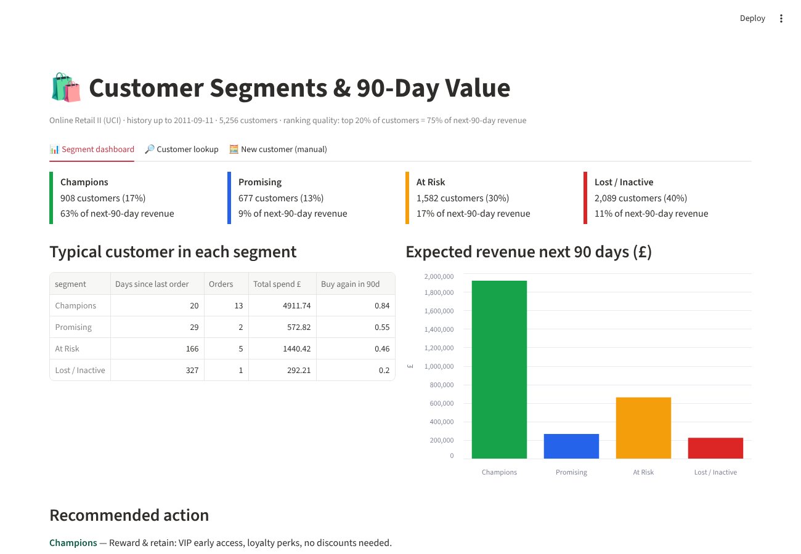
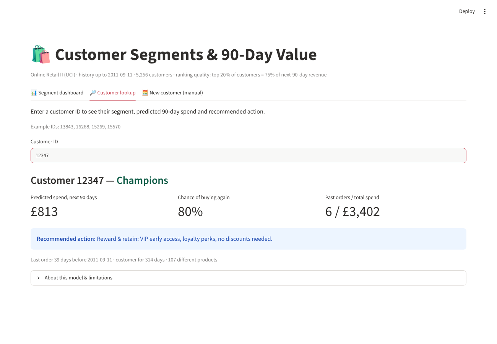

# Customer Lifetime Value & Segmentation Engine

> Group online-retail customers by behaviour (K-Means on RFM) and predict how much each will spend in the next 90 days — so marketing knows who to reward, who to win back and where to spend its budget.

**🔗 Live app:** https://clv-segmentation-engine.streamlit.app  ·  **Code:** https://github.com/Seif-Hesham1/customer-lifetime-value-segmentation

| Dashboard | Customer lookup |
|---|---|
|  |  |

## Results (held-out test customers)

| Model | MAE £ | RMSE £ | R² | Share of total revenue predicted | Top-20 % revenue capture |
|---|---|---|---|---|---|
| Baseline (mean) | 742 | 1,993 | 0.00 | 110 % | 22 % |
| Baseline (predict £0) | 529 | 2,061 | -0.07 | 0 % | – |
| Single GB on log-spend | 385 | 1,371 | 0.53 | **44 %** | 75 % |
| **Two-part: P(buy) × spend** (deployed) | 444 | 1,388 | 0.51 | 120 % | **75 %** |

* P(buy again) test **ROC-AUC 0.82**.
* The single log-spend model has a slightly lower MAE but badly under-predicts total revenue (44 %), so it can't size "revenue at stake". The two-part model gives a purchase probability and calibrated totals — that is the one deployed.
* Segments (K-Means, k = 4, silhouette 0.38): **Champions** (17 % of customers → 63 % of next-90-day revenue), **Promising**, **At Risk** (30 % of customers, £3.2 M historic spend, silent ~166 days) and **Lost / Inactive**.

## How it works
1. **Cleaning:** 1,067,371 invoice lines → 776,577 (returns, guest checkouts, non-product codes, duplicates removed).
2. **No leakage:** features come only from purchases *before* 2011-09-11; the target is spend in the 90 days *after*. Customers are split train/test before any fitting.
3. **Segmentation:** log-scaled Recency / Frequency / Monetary → K-Means (compared with Ward hierarchical clustering; PCA used for visualisation).
4. **Value model:** Part A classifier (will they buy?) × Part B regressor (how much if they buy?) with calibration; 3 algorithms each, `RandomizedSearchCV`, selection by cross-validation only.
5. **App:** Streamlit — segment dashboard, customer-ID lookup, manual scoring for new customers.

## Run it
```bash
pip install -r requirements.txt
streamlit run app.py
```
To re-create the notebook and artifacts, download **Online Retail II** from the UCI link below, save it as `data/online_retail_II.csv` (both sheets concatenated, columns unchanged) and run:
```bash
pip install jupyter matplotlib seaborn openpyxl
python mknb.py notebook_src.py clv_segmentation.ipynb   # or open clv_segmentation.ipynb → Restart & Run All
```

## Files
| File | What |
|---|---|
| `clv_segmentation.ipynb` | Full analysis (runs top to bottom) |
| `app.py`, `clv_utils.py` | Streamlit app + shared prediction helper |
| `artifacts/` | Saved models, customer table, metrics |
| `presentation.pptx` | 12-slide deck |
| `linkedin_post.md`, `cv_bullet.md` | Portfolio texts |

## Limitations
One cut-off (Sept 2011) and a Q4 peak-season target window, a single UK wholesaler, purchase history only, revenue not profit. Use the score mainly to **rank** customers.

## Data credit
Chen, D. (2012). *Online Retail II*. UCI Machine Learning Repository. https://archive.ics.uci.edu/dataset/502 (CC BY 4.0). Raw data is not included — download it from the link.
